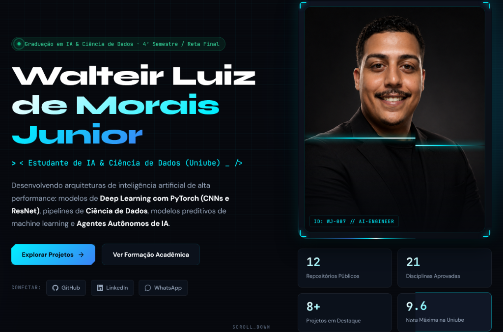

# 🚀 Walteir Junior — Portfólio de IA & Ciência de Dados



<div align="center">

[](https://github.com/wjr007)
[](https://www.linkedin.com/in/walteir-luiz-de-morais-junior-42a21928a/)
[](https://wa.me/553496583020)
[](#-formação-acadêmica)

</div>

---

## 👨‍💻 Sobre Mim

Olá! Sou o **Walteir Luiz de Morais Junior (Walteir Jr.)**, desenvolvedor e pesquisador em **Inteligência Artificial & Ciência de Dados**, na reta final da graduação (4º semestre / 2026) pela **Universidade de Uberaba (Uniube)**, acumulando mais de **21 disciplinas concluídas com médias de excelência** (destaques em Matemática Aplicada à IA: 9.2, Algoritmos: 9.1, Análise de Dados: 9.0 e Gestão de Projetos: 9.5).

Meu foco é transformar problemas complexos de negócios em **soluções inteligentes e escaláveis**, combinando fundamentos matemáticos rigorosos com código limpo em Python, redes neurais profundas com PyTorch, pipelines de dados modernos e arquiteturas de agentes autônomos.

---

## ⚡ Habilidades de Mercado & Stack Tecnológica

```
┌─────────────────────────────────────────────────────────────────────────────┐
│                      CORE COMPETENCIES & TECH STACK                         │
├────────────────────────┬──────────────────────────┬─────────────────────────┤
│  DEEP LEARNING & IA    │   DADOS & ENGENHARIA     │  SISTEMAS & FERRAMENTAS │
├────────────────────────┼──────────────────────────┼─────────────────────────┤
│ • PyTorch & ResNet     │ • Pandas & NumPy         │ • Git & GitHub CI/CD    │
│ • CNNs & Visão Comp.   │ • Databricks & MLflow    │ • Docker & Linux        │
│ • NLP (NLTK / spaCy)   │ • Delta Lake & ETL       │ • n8n (Agentes IA)      │
│ • Scikit-Learn         │ • SQL (Postgres/SQLite)  │ • Power BI & Dashboards │
│ • Agentes IA & LLMs    │ • Análise Estatística    │ • Flask & REST APIs     │
└────────────────────────┴──────────────────────────┴─────────────────────────┘
```

### 🧠 Deep Learning & Machine Learning
- **Redes Convolucionais & Visão Computacional:** Implementação de CNNs do zero, arquiteturas LeNet-5 e ResNet com *residual blocks* e *skip connections* em PyTorch.
- **Processamento de Linguagem Natural (PLN):** Engenharia de features textuais, TF-IDF, lematização, tokenização e modelos preditivos de classificação de sentimentos.
- **Machine Learning Tradicional:** Regressão, árvores de decisão, Random Forest, algoritmos de clustering (K-Means) e pipelines com Scikit-Learn.
- **Agentes Inteligentes:** Construção de agentes autônomos, assistentes multimodais acionados por áudio/voz e orquestrações com n8n.

### 📊 Ciência & Engenharia de Dados
- **Análise Exploratória & Estatística:** Extração de insights, testes de hipóteses, correlações e visualizações com Matplotlib e Seaborn.
- **Ecossistema Databricks:** Formação prática em Lakehouse, Delta Lake, orquestração e rastreamento de experimentos com MLflow.
- **Bancos de Dados:** Modelagem relacional, otimização de queries em SQL (PostgreSQL, SQLite), migrações e boas práticas de integridade.

---

## 🛠️ Projetos Desenvolvidos em Destaque

| Projeto | Descrição | Tecnologias | Repositório |
| :--- | :--- | :--- | :---: |
| **Coleção Deep Learning (Labs 01 ao 08)** | Série prática completa de Deep Learning em PyTorch: desde tensores e autograd até classificação avançada com CNNs e ResNet. | `PyTorch` `Python` `CNN` `ResNet` `Computer Vision` | [Ver no GitHub](https://github.com/wjr007/Deep-Learning-1-ao-8) |
| **Deep Learning ResNet & Visão Computacional** | Implementação de arquiteturas modernas de redes neurais residuais com skip connections para alta precisão em visão computacional. | `PyTorch` `ResNet` `LeNet-5` `Deep Learning` | [Ver no GitHub](https://github.com/wjr007/Deep-Learning-Pytorch-ResNet) |
| **Jarvis — Desktop AI Agent** | Assistente pessoal inteligente em Python com ativação por palmas e reconhecimento de voz, planos multi-etapa e console local. | `Python` `AI Agent` `Speech Recognition` `Automation` | [Ver no GitHub](https://github.com/wjr007/jarvis) |
| **Processamento de Linguagem Natural (PLN)** | Pipeline completo de análise de sentimentos em tweets com tokenização, lematização, vetorização TF-IDF e regressão logística. | `Python` `NLP` `NLTK` `Scikit-Learn` `TF-IDF` | [Ver no GitHub](https://github.com/wjr007/Processamento-de-Linguagem-Natural-PLN-) |
| **Classificação de Imagens com CNN** | Modelo convolucional profundo para reconhecimento e classificação de imagens (Cats vs Dogs) com data augmentation e regularização. | `PyTorch` `CNN` `Data Augmentation` `OpenCV` | [Ver no GitHub](https://github.com/wjr007/Processamento-de-Imagem) |
| **Análise Preditiva de Admissão com IA** | Pipeline de dados de ponta a ponta: extração SQL, EDA, engenharia de atributos e modelos de Machine Learning para predição de candidatos. | `Machine Learning` `Random Forest` `EDA` `SQL` | [Ver no GitHub](https://github.com/wjr007/Analise-Admissao-Candidatos-IA) |
| **Análise de Portfólio B3 (Varejo)** | Análise estatística e financeira de ações do varejo na bolsa brasileira, com coleta histórica, banco SQLite e relatórios automatizados. | `Python` `Pandas` `SQLite` `B3` `Finanças` | [Ver no GitHub](https://github.com/wjr007/An-lise-de-Dados-) |
| **Dashboard Analítico** | Interface responsiva e moderna de visualização de métricas e exploração interativa de dados em plataforma web. | `TypeScript` `Web` `Data Viz` `UI/UX` | [Ver no GitHub](https://github.com/wjr007/Dashboard) |

---

## 🎓 Formação Acadêmica & Certificações

### Graduação
* **Inteligência Artificial & Ciência de Dados** — Universidade de Uberaba (Uniube)
  * **Período:** 2025 – 2026 (4º Semestre / Reta Final de Conclusão)
  * **Disciplinas Aprovadas (21):** Matemática Aplicada à IA, Algoritmos e Estruturas de Dados, Banco de Dados I e II, Análise de Dados, Cloud Computing, Programação Orientada a Objetos, Python Aplicado à IA, Arquitetura de Computadores, Estatística Aplicada, Segurança e Auditoria de Sistemas, entre outras.
  * **Em Conclusão (Semestre 4):** Deep Learning, Machine Learning, Big Data Analytics & Data Mining, Ciência de Dados e Projetos Integrados.

### Certificações & Imersões Práticas
* **Imersão Databricks + Claude Code** — *Jornada de Dados* (8h · ago/2026)
  * Desenvolvimento assistido por IA, Delta Lake, Lakehouse e MLflow.
* **Intensivão de Power BI** — *Hashtag Treinamentos* (8h · fev/2026)
  * Dashboards gerenciais, tratamento de dados e modelagem analítica.
* **Imersão Agentes IA** — *Hashtag Treinamentos* (8h · fev/2026)
  * Arquitetura e implementação de agentes autônomos com LLMs.
* **Expert Ads** — *Destrava Academy / Via Up* (100h · abr/2024)
  * Especialista em tráfego pago, análise de métricas de conversão e gestão de campanhas.

---

## 🌐 Como Rodar o Portfólio Localmente

O portfólio web foi desenvolvido com tecnologias web nativas (HTML5, Vanilla CSS com design system de alto nível e JavaScript modular):

```powershell
# Clone o repositório
git clone https://github.com/wjr007/Portf-lio.git
cd Portf-lio

# Inicie o servidor local (Python)
py -m http.server 8000

# Abra no seu navegador:
# http://localhost:8000
```

---

## 📬 Contato & Redes

- **LinkedIn:** [walteir-luiz-de-morais-junior](https://www.linkedin.com/in/walteir-luiz-de-morais-junior-42a21928a/)
- **WhatsApp:** [+55 (34) 9658-3020](https://wa.me/553496583020)
- **GitHub:** [@wjr007](https://github.com/wjr007)
